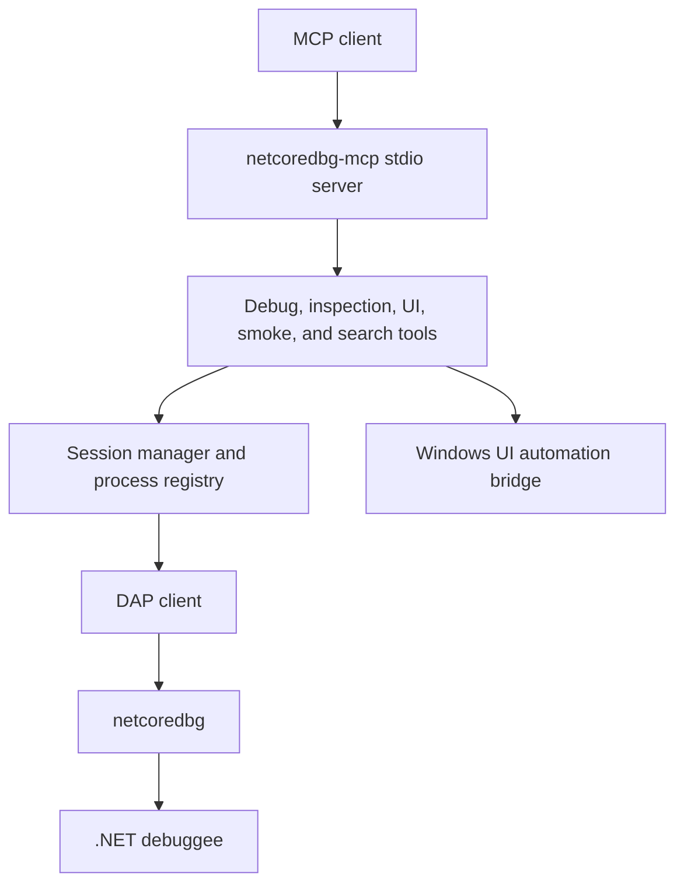

[English](README.md) | [Русский](README.ru.md)

# netcoredbg-mcp

[](https://pypi.org/project/netcoredbg-mcp/)
[](LICENSE)
[](#requirements)
[](https://modelcontextprotocol.io/)
[](#limitations)

Debug .NET applications from an MCP-capable coding agent without leaving the
agent workflow. `netcoredbg-mcp` combines `netcoredbg`, the Debug Adapter
Protocol, and Windows UI Automation so an agent can observe a running app,
stop it deliberately, and inspect the state that explains the behavior.

**Python 3.10+ · Windows GUI automation · 135 tools · 8 prompts · 4 resources · v0.23.17**

The prepared v0.23.17 PATCH fixes nullable launch environments (#362): string
overrides survive beside `null`, and `null` removes inherited variables, including
Windows case variants. An idle adapter uses guarded drain/restart; with
`pre_build=False`, removal requests refuse an active debuggee without stopping it.
The parent and pre-build environments stay unchanged. Python remains the default.
Upgrade and restart the MCP server; this does not hot-reload shared receivers.
See the [release notes](RELEASE_NOTES.md) for scope and verification boundaries;
preparation is not publication.

## What it enables

| Need | Use the MCP server to |
|---|---|
| Understand a failure | Launch or attach to a .NET process, set breakpoints, inspect threads, stacks, scopes, variables, modules, output, and exceptions. |
| Drive a desktop app | Find UI elements, read window trees, click, type, select, use the clipboard, and gather bounded WPF, WinForms, or Avalonia evidence. |
| Keep evidence honest | Capture a preview for navigation or opt in to a lossless screenshot artifact with integrity metadata. |
| Verify a repair | Run a bounded runtime-smoke plan with cleanup, output checkpoints, freshness checks, and recorded evidence. |
| Search a project | Find C# symbols and references, read source context, or run a bounded `search_source` query. |

The Python package remains the default consumer entry point. Its wheel does not
bundle the opt-in .NET preview executable. Corrected preview delivery is separate;
B3 native `step_over`, the native step pair and Native Scene Probe work remain
modern-host source-only and add no tools to the Python catalog.

The source-built stateful host also accepts initialize-era MCP clients through
the SDK's version negotiation. Its catalog and explicit `debugSessionId` inputs
remain native, not the Python tool contract; legacy-client cutover, resources,
and full catalog parity are still open (Engram #552). The separate published
read-only preview retains its modern-only protocol boundary.

The source-built stateful host has an experimental, explicitly selected
`--legacy-compat` mode for a **single process-local console session**. It exposes
only `start_debug`, `attach_debug`, `get_debug_state`, `debuggee_activity`, `get_threads`, `get_call_stack`,
`get_scopes`, `get_variables`, `evaluate_expression`, `quick_evaluate`, `set_variable`,
`add_breakpoint`, `remove_breakpoint`, `add_function_breakpoint`, `remove_function_breakpoint`, `list_breakpoints`, `clear_breakpoints`, `configure_exceptions`, `get_exception_info`,
`get_stop_context`, `get_exception_context`, `create_snapshot`, `list_snapshots`,
`diff_snapshots`, `analyze_collection`, `summarize_object`, `get_modules`, `get_progress`, `get_loaded_sources`, `get_step_in_targets`, `read_memory`, `write_memory`, `disassemble`, `get_locations`,
`step_over`, `step_into`, `step_out`, `pause_execution`, `continue_execution`,
`get_output`, `get_output_tail`, `search_output`, `output_checkpoint`, `output_assert_since`, `verify_debug_freshness`,
`get_build_diagnostics`, `stop_debug`, `cleanup_processes`, `restart_debug`, `terminate_debug`, `find_code_symbol`,
`find_code_references`, `get_source_context`, `search_source`, `add_tracepoint`,
`remove_tracepoint`, `get_trace_log`, `clear_trace_log`, `mark_trace_cursor`,
`get_trace_delta`, `instrumentation_group_create`, `instrumentation_group_inspect`,
`instrumentation_group_clear`, and `debug_hygiene_preflight`. Debug operations use implicit session binding
and selected Python-style response envelopes.
Without the flag the native catalog and explicit session contract are unchanged.
This mode does not use the Python backend and
does not change the installed Python default or provide full #552 compatibility.

The source-built legacy `attach_debug` route is Windows-only. It retains a
handle to the requested process and, after a possible attach write, sends at
most one non-terminating disconnect. An adapter acknowledgement does not prove
CLR detach or target survival, so stop reports an unconfirmed outcome. Cleanup
and host shutdown can remain pending until protocol work settles and the target
exits. Safety after an unexpected host or adapter exit is not established.
When `terminate_debug` falls back to disconnect for an attached process, it uses
the same retained owner and unconfirmed-detach reporting. `configurationDone` is
sent during attach only when the adapter advertises that capability.

In this source-built mode, `cleanup_processes` reads process observations by
default. `force=true` joins existing cleanup and requires the active session's owner;
an attached target still reports unconfirmed detach. Observed PIDs and their
current liveness do not prove process-instance identity and never authorize
termination. Liveness can be null; `alive_unknown` counts those observations.
On Unix the owned proxy is labelled `adapter_guardian`, not `netcoredbg`.
The response marks incomplete bounded observations explicitly; they do not block
owner cleanup. `terminated` counts confirmed forced roots for that operation on
Windows; on Unix it remains zero because the proxy does not establish the cause.
It does not count descendants. On Windows, successful owner cleanup requires the
owned Job's active-process count to reach zero. If termination or drain cannot be
confirmed, the Job owner remains available for retry. `tree_terminated` and
`tree_drained` remain null: Job accounting does not prove the state of processes
outside that Job. Owner counts refer to native session slots, not Python's
individual callback registrations.

`debuggee_activity` observes reader-received DAP events and legacy trace entries
over 1–30,000 ms (default 1,000) from an initially running session. It does not
measure executed instructions. A successful launch is projected as running until
the first lifecycle event, as in Python; this is not an observed DAP `continued` event.
Unprojectable states, including stops without a thread ID, are refused.

`verify_debug_freshness` compares recorded process metadata, the selected project
root, reader-observed source and module inventories, and artifact existence.
`require_active_process` checks only whether a PID was recorded: neither it nor
`PASS` proves that a process is alive or is the original process instance. The
observations and filesystem checks are not an atomic snapshot. Incomplete native
inventories or oversized results are refused. Missing requested observations
produce warnings; without expectations and `require_active_process`, `PASS` can
occur even without a session or observations. An identified foreign mux owner is
refused, an untagged direct read remains allowed, and this read does not claim
or hold ownership. A named read is refused if a different named owner appears before
it publishes its result. Native name matching uses .NET case-insensitive comparison
and invariant lowercasing, not Python's full Unicode `casefold`; path display and
normalization also follow .NET rules. Full parity remains open (#552, #550). The
standalone tool does not populate Python runtime-smoke evidence storage.

`get_build_diagnostics(include_warnings=true)` reads the latest accepted legacy
pre-build result, retained across stop. A new pre-build clears the prior result;
an incomplete or rejected attempt does not expose stale diagnostics. Completed
failures include the executed stage, argv, working directory and retained output.
Native restore and build use separate commands; only the final stage and final
retry output are reported. Each output stream retains at most 5,000,000 UTF-16
characters. At that limit, counts are unavailable because output may be truncated.
Timeout and cancellation omit partial output and report incomplete diagnostics;
launch or cleanup failures may leave no result. Diagnostic parsing follows the
Python location and simple MSBuild patterns, with native line splitting. Unlike
Python, native returns an error without partial data if the response exceeds
256 KiB, a line exceeds 256 Ki UTF-16 code units, parsing exceeds two seconds,
or one regex match exceeds 100 ms. This does not change the modern API or Python
default.

Legacy `search_output` is a shared, non-consuming read using case-insensitive,
culture-invariant .NET regex, category filtering before line splitting, a total
match count and at most 50 returned matches. Checkpoint creation and assertion
require the active mux owner; an idle checkpoint survives the first successful
start, natural termination retains it and successful stop clears it, including
when the host is already idle and cleanup is confirmed. Output
removed by whole-buffer clear, entry truncation or retention trimming after a
checkpoint makes the assertion fail. Filtered reads do not clear output.
If adapter startup was attempted but the start is refused, cancelled, or otherwise
not published, existing checkpoints conservatively fail even when no output was
observed: unpublished output may have been lost. Pre-adapter validation failures
do not invalidate them. Unconfirmed cleanup rejects idle checkpoint operations.
Assertions support literal and case-sensitive .NET regex matching. Unlike the
Python implementation, forbidden matches still fail when `max_matches` is zero
or negative. `forbidden_count` reports all matched pattern/line pairs even when
evidence is capped; evidence limits do not change assertion truth. Native assertions
limit checkpoints to 1024, patterns to 256 of up to 4096 UTF-16 code units,
captured text to 2 Mi UTF-16 code units, evidence per list to 256 matches and
serialized responses to 256 KiB; time and size limits return errors. Regex and
Unicode behavior are not full Python parity (#549).

`restart_debug` retains the last successful launch configuration. Its default
`rebuild=true` requires a saved `build_project`; `rebuild=false` preserves the
saved `pre_build` setting. `terminate_debug` sends DAP terminate only when the
adapter advertises support and waits for a terminal event; otherwise it uses
disconnect. An uncertain termination is not retried automatically.

Function breakpoint requests persist in the host process across stop/start.
Global `list_breakpoints` includes `__function_breakpoints__`; file-filtered
listing and `debug://breakpoints` contain source breakpoints only. Global clear
also removes function breakpoints. Active changes replace the complete function
set and require mux ownership. The adapter must advertise
`supportsFunctionBreakpoints`: deferred entries are retained but not sent when
support is absent, and active adds are rejected. `verified` reflects the last
acknowledged DAP response, not a hit or later breakpoint event. Conditions and
hit conditions are passed to the adapter; it may ignore them without the
corresponding DAP capabilities. An uncertain write is not retried automatically.
When function and source breakpoints are both active, a generic breakpoint stop
can make source hit counts unavailable rather than attributing it incorrectly.
If the adapter refuses an update to an existing function breakpoint, the native
route retains its previous entry; the Python route currently removes it. Each
debug session retains up to 4,096 distinct observed function-breakpoint IDs to
avoid misattributing late events. Exceeding that limit makes source breakpoint
observations unavailable until a new debug session is started.

The three memory inspection tools require their corresponding DAP capabilities.
`read_memory` with a zero count returns empty data only after the capability
check. Reads are not restricted to stopped sessions, but a lifecycle change
invalidates an in-flight result. Responses are bounded to 256 KiB and invalid
or oversized responses fail rather than return partial data. Numeric inputs
are limited to signed 32-bit integers. Stack and variable projections do not
expose new references. Adapter support and consumer verification are separate.

`write_memory` is destructive, requires mux ownership and an advertised
`supportsWriteMemoryRequest`, and accepts strict base64 with a signed 32-bit
offset. It can run while the session is running or stopped. A write invalidates
the previous inspection context. If the session or lifecycle changes during a
dispatched write, or its outcome is otherwise uncertain, it may have executed;
do not retry automatically. Uncertain cleanup can close the session and terminate
a launched debuggee. For an attached target, the host retains cleanup ownership
and returns without waiting indefinitely for the target to exit; detach remains
unconfirmed. Native input size and numeric bounds differ from Python. Adapter
support and consumer verification remain separate.

The legacy context tools return Python-style `data` envelopes from one native
stopped epoch. Stop context includes up to five frames, 15 first-scope locals,
retained output entries and observed hit counts; pending or incomplete hit
observations return an error. Exception context includes at most 20 frames and
up to 20 variables from each available scope of up to five frames. Exception
information requires adapter support. Both responses are
bounded to 256 KiB and fail instead of returning partial or stale data. Unlike
the modern tool, legacy `max_inner_exceptions` defaults to 5: evaluation may
run debuggee code and requires mux ownership. Set it to 0 to avoid evaluation.
An uncertain evaluation is not retried. Native refusal, size and paging limits
are not full Python parity.

Legacy snapshots are process-local, survive `stop_debug`, reject duplicate names
and evict oldest first. `NETCOREDBG_MAX_SNAPSHOTS` defaults to 20 (supported
range 1–1024), and `NETCOREDBG_MAX_VARS_PER_SNAPSHOT` defaults to 200 (1–256).
Instead of Python's partial capture at the variable limit, the native route
returns an error. Collection and object tools require a current `get_call_stack`
selection by the same mux caller. They inspect at most 256 variables per DAP
response, at most 256 object properties and 256 traversal requests; depth is
clamped to 1–5. A 256 KiB work budget includes per-variable overhead, and the
serialized response has a separate 256 KiB bound. Limit violations fail rather
than returning silent partial data. Sorting uses .NET ordinal string order;
non-finite numeric collection values are refused. Full Python parity is not claimed.

The four native code-search tools work before and during a session. Their
Python-style envelopes report the current observed state at response time.
Operator project pins remain authoritative; otherwise initialize-era client
roots are resolved per request, with the existing startup-directory fallback.
`search_source` uses case-sensitive .NET regular expressions, not Python `re`
parity, and returns at most 1,000 matches. Its timeout is cooperative and
bounds each regex match; blocked file I/O or glob matching may exceed it.

Mux mutation admission uses `_meta.muxSessionId`; reads remain available while
execution waits, and the opt-in mode advertises `experimental.x-mux` with
`sharing: isolated`. An untagged start owns its session until confirmed stop;
tagged callers cannot claim it. All untagged calls are indistinguishable; this is
not client authentication. Conversely, untagged mutations are refused while an
identified mux owner exists, unlike Python. An identified owner may expire
after `NETCOREDBG_SESSION_TIMEOUT` seconds (default 60), but never during an
in-flight start, stop, or active breakpoint update. Rejected starts do not
acquire ownership. `stop_debug` waits for an in-flight start, including pre-build,
and cannot interrupt it; the start request's cancellation route remains available.
The legacy route exposes
`debug://output` (text/plain) and `debug://threads` (application/json) with
connection-scoped subscriptions. Subscriptions survive stop/start on the same
connection. Updates are coalesced URI invalidations, not session snapshots;
pending invalidations can carry across stop/start, and reads resolve the current
session. If a notification send is blocked, the server waits at most two seconds
for the subscribe/unsubscribe notification gate and returns an error if it cannot
synchronize. A blocked transport can delay any response, but debugger start, stop
and shutdown do not wait for notification delivery internally.
Output reads return the current retained buffer, including an empty idle buffer;
thread reads issue a native threads request and report errors when unavailable.
`debug://state` is supported; complete resource parity remains open.
A second start is refused until the bound session is stopped. An observed DAP
exit or termination and its observed exit code remain visible until explicit
stop, including while cleanup is in progress; failed cleanup or a retirement
without a terminal event reports `unknown`. Pending execution also reports
`unknown` when native evidence does not establish a state. State
fields, stack source context, application-type detection, notifications,
terminal and timeout results, and Python's full action hints are not equivalent.
`get_call_stack` selects the top frame and stopped inspection context for later
scope, variable and evaluation calls. The selection belongs to that mux client;
if another client selects a stack, select your own stack again. Untagged callers
cannot be distinguished from each other. Execution also invalidates the selection;
select a fresh stack before inspecting again. Numeric frame and variable IDs are
not tracked as previously issued: after reselection a reused numeric ID cannot
be distinguished from an old one. Non-null variable filters are rejected;
variable paging is nonnegative. Unlike
Python, evaluation is subject to mux mutation ownership because expressions can
change the debuggee. Uncertain evaluation and breakpoint writes are not retried.
If the stopped context changes before a stack, scope, variable or evaluation
response is published, the legacy route returns an error instead of mixing
epochs. A dispatched evaluation may already have executed; an unknown outcome
must not be retried automatically.

`quick_evaluate` requires a running session and mux ownership. It requests a
pause, waits for a matching stopped thread, evaluates once and resumes the same
current stop after a successful or explicitly rejected evaluation. A breakpoint
or changed stop observed before resume, or a pause, stop or restart admitted
before resume write admission, prevents that automatic resume.
DAP does not correlate a stopped event to a particular pause request, so an
indistinguishable external pause cannot be ruled out. Cancellation or an
unconfirmed write is not retried and may close the debug session; a failed
operation may leave the program stopped. A supplied `frame_id` is not tracked as
previously issued. Resume acknowledgement does not guarantee that the program
is still running when the response is received.

Source-line breakpoints can be added or removed while idle. Optional `condition`
and `hit_condition` are retained with the requested location and applied only if
the adapter advertises the corresponding DAP capability. An unsupported option
returns an error; deferred intent prevents launch until changed or supported.
The aggregate serialized condition and hit-condition values are limited to 252 KiB.
The host keeps up to 256 requested locations for its lifetime and reapplies them on
each start; an idle add reports `verified: false`. A validated, admitted active
change enters the desired set before dispatch, and a concurrent breakpoint update
is refused rather than queued. Stop remains available during an update; new starts
and idle mutations are refused while an earlier update is settling. A refusal
retains intent but reports that the live debugger rejected the file set, unlike
Python's response. An uncertain write retains intent with application unknown;
it is never retried automatically. A later explicit add/remove for that file or
an explicit start can resend the desired set after the prior session is cleaned up.
Sources for adds must exist. Paths are relative to the host's startup working
directory and existing links are resolved, but lexical `..` is collapsed before
link resolution and dangling links are not resolved, unlike Python `realpath`.
`list_breakpoints`, `clear_breakpoints` and the subscribable
`debug://breakpoints` resource cover these source locations only.
Verification and adjusted lines come from DAP acknowledgements and matching
breakpoint events; a matched removal event removes the requested entry. If IDs
are missing, reused or exceed the observation limit, listing and resource reads
return an error instead of stale observations, including after stop. Clearing all
requested entries or a later start with complete observations restores reads.
Hit counts use the debugger-adjusted line when present, otherwise the requested
line, and are derived asynchronously from the stopped thread's top frame. Unlike
Python's first-match behavior, an adjusted breakpoint is not also attributed to
its original line. If several requested points share the stopped effective line,
attribution is unavailable rather than assigned arbitrarily. Counts reset on stop;
pending or unavailable attribution returns an error. Clear records all requested removals first;
on a file-set refusal or uncertain result it stops dispatching further files and
does not retry automatically.

Instrumentation groups own their breakpoints and tracepoints separately from
directly added points. Clearing a group leaves independent owners in place;
confirmed stop or restart clears groups but retains independent requests. Shared
stopping points with identical conditions retain those conditions. If an
unconditional stopping point shares the line, the physical breakpoint is
unconditional. The native route rejects differing non-empty predicates, even when
an unconditional owner also exists, and rejects a conditional group breakpoint
sharing a line with a tracepoint. This is not full Python parity. If a group file
replacement is refused or unconfirmed, the group is retained and source
mutations for that normalized file are refused until confirmed stop. Trace
observation remains conservative when filenames are ambiguous. Inspection
reports failure when application or required hit counts are unconfirmed.

By default, `debug_hygiene_preflight` clears direct breakpoint and tracepoint
requests and the trace log. It can target one project file; exception filters
are cleared only when requested. Group-owned points are retained and cause
`FAIL` while in scope. Global results include remaining function breakpoints.
An unconfirmed update reports `FAIL` and is not retried automatically.

`set_variable` requires mux ownership and the calling client's selected stopped
context. After an admitted attempt, select a fresh stack before inspecting or
mutating variables again. An uncertain sent mutation may have executed and must
not be retried automatically. `configure_exceptions` is owner-guarded; omitted
or null filters mean an empty list; malformed arguments are rejected without
changing filters. It reports configuration only after native acknowledgement,
not proof of a later exception stop. `get_exception_info` is a
read fenced to the current stopped context. Unlike Python's null result on a
negative response or missing thread, native capability absence, refusal and a
missing stopped context are reported as errors. Native inspection and filter
size bounds still apply.

`get_modules` and `get_progress` read bounded, reader-observed event inventories;
incomplete or oversized inventories return errors. `get_loaded_sources` asks the
adapter and refreshes the native live-source view when supported. The legacy
`debug://state` resource exposes the observed state and connection-scoped update
notifications. Thread data is null until observed or after a thread transition;
active debuggee liveness is unknown rather than inferred from a PID. Reads fail
when an inventory is incomplete, unavailable or exceeds the 256 KiB resource
limit, or while a session transition is in progress. The independently captured
inventories are not an atomic debuggee snapshot. Native progress retains Python's
snake-case and camel-case ID/time aliases. Full resource parity remains open.
Memory-event offsets must be integers between -9,007,199,254,740,991 and
9,007,199,254,740,991; counts must be between zero and that positive limit.
Invalid supplied fields make the state resource unavailable rather than zeroing them.

`get_step_in_targets` requires mux ownership and the calling client's selected
stopped frame and context. Omitted, null or zero `frame_id` uses that frame.
Unlike Python, which returns an empty list on a negative DAP response without a
capability check, native capability absence or refusal returns an error. Targeted
`step_into(target_id=...)` uses the selected context and invalidates the selection;
select a fresh stack afterwards. Target IDs are not tracked as previously issued:
after reselection a reused numeric ID cannot be distinguished from an old one.
Both step operations use the observed stopped thread when omitted. An uncertain
sent step may have executed and must not be retried automatically. A successful
pause acknowledges the request, not a stopped event. State may remain `unknown`
until the debugger confirms a transition, for example with a continue
acknowledgement or DAP event.
Output is empty before start and after stop; output observed before natural
termination remains available until stop while the implicit session is retained.
Filtered `get_output(clear=true)` does not clear; clearing the entire buffer
requires mux ownership, unlike Python. Native retention defaults to 100,000
Unicode code points per event and 10,000,000 in total, truncating oversized
entries and evicting oldest entries. Tail line counts are limited to signed
64-bit integers. These limits and native event delivery can differ from Python.

Stack pages are limited to
256 frames. `stealth_mode=true` and unrecognized arguments are rejected. Python's
`pre_build=true` default is retained, but native pre-build requires an explicit
`build_project`; use `pre_build=false` for an existing binary. Native launch
profile, environment and process cleanup limitations still apply. This source
mode requires separate consumer verification before any cutover.


The source-built stateful host accepts `args`, `cwd`, and `stopAtEntry` in
`start_debug`. String arguments are sent to DAP in order, including empty
strings; an explicit empty array is retained. Omitted or null options are not
sent, and an empty `cwd` is treated as omitted. When omitted, the adapter chooses
its own working-directory default; this is not a claim of Python's launch
defaults. The adapter's successful launch acknowledgement does not prove the
program is still running. A negative launch response returns `DAP_LAUNCH_REFUSED`
only after failed-start cleanup succeeds; no session token is returned.
An explicit nonempty `cwd` must name an existing directory before the adapter
starts, or the host returns `START_DEBUG_CWD_UNAVAILABLE` without a token.
Relative paths are checked from the host working directory. This is a point-in-time
check, not a pinned directory identity or proof that the debuggee later used it.

The optional `justMyCode` boolean controls the adapter's user-code filtering;
omitting it leaves the adapter default. Python launches with `justMyCode: false`.

The optional `env` object passes string values, including empty strings, to the
debugger for the debuggee; a `null` value removes that name from the owned adapter
and its debuggee. It does not change the host environment or another session.
Names cannot be empty or contain `=` or NUL; values cannot contain NUL. Names
are case-insensitive on Windows and case-sensitive on Unix. The internal
`NETCOREDBG_MCP_NATIVE_SCENE_PROBE_PIPE` and
`NETCOREDBG_MCP_NATIVE_SCENE_PROBE_NONCE` names are reserved and cannot be set
or removed. When removing `PATH` for a DLL, the host resolves `dotnet` from its
own PATH first; if unavailable, it returns `START_DEBUG_DOTNET_UNAVAILABLE`
before starting the adapter.

The local netcoredbg 3.1.3-1 on Windows code page 1251 corrupted non-ASCII
environment names and values in both the native and installed Python paths
(Engram #551). Do not assume Unicode environment parity from this option.

`start_debug` loads the optional `.netcoredbg-mcp.launch.json` (maximum 16 MiB)
from the selected project. An explicit `projectRoot` takes precedence; otherwise
the host uses `NETCOREDBG_PROJECT_ROOT`, `MCP_PROJECT_ROOT`, `--project`, a
valid local MCP client root, then its startup directory. `--project-from-cwd`
searches for solution, project, or Git markers before using the startup directory.
A configured but unavailable operator scope fails closed rather than selecting a
client root. Modern clients may receive `input_required` for client roots before
the adapter starts.
For initialize-era clients, a failed or timed-out `roots/list` falls back to the
startup directory or `--project-from-cwd` selection; an operator pin still wins.
MCP roots are deprecated in protocol version 2026-07-28 but remain supported
here for existing clients.

`launchProfile` selects a named profile; otherwise `defaultProfile` or `default`
is used. Required inherited variables are applied first, then profile values,
then direct `env` overrides. A missing requested profile or invalid file returns
`START_DEBUG_LAUNCH_PROFILE_INVALID`; an unavailable root returns
`START_DEBUG_PROJECT_UNAVAILABLE`. The optional `launchEnvironment` result
contains names and counts, never values.

Set `preBuild: true` and `buildProject` to restore and build before launching;
`buildConfiguration` is `Debug` or `Release` (default `Debug`). The equivalent
snake-case fields and `stop_at_entry`/`launch_profile` are accepted; supplying
both spellings of one field is invalid. Pre-build defaults to false in this
native host, unlike Python's tool default. Relative build-project and program
paths resolve from the host working directory. Network/device paths and build
project paths containing links or reparse points are refused.
These are point-in-time path checks, not a pin against later project changes.

The build uses the selected project root as its working directory, does not use
debuggee `env` overrides, and disables persistent build servers. It refuses to
start while another native session or start is active; it never stops another
session. Completed build failures include bounded stdout/stderr tails and
truncation flags. On Windows, command cleanup requires zero active processes in
the owned Job. On Unix, cleanup covers the owned process group, not descendants
that escape it. Unconfirmed cleanup blocks later starts until the host restarts.

The same project selection supports the source-built native `find_code_symbol`,
`find_code_references`, and `get_source_context` tools. Their results do not
report an implicit debug-session state. Python's full search and launch contract,
including pre-build and launch defaults, remains incomplete in the native host.
Python remains the installed default.

In the source-built stateful host, `start_debug` also accepts an optional
`breakpoints` array of up to 256 `{file, line}` entries. Each source file must
exist; relative paths resolve from the host's working directory, and lines are
one-based. The optional `initialBreakpoints` result records the debugger's
initial verification only: `verified: false` can become bound after launch.
Use the returned `debugSessionId` and, when available, the observed
`state.currentThreadId` to inspect or step a stopped thread. This input is not
part of the published read-only preview or the Python tool contract.

After launch, `add_breakpoint(debugSessionId, file, line)` adds an
unconditional source breakpoint while the session is running or stopped. Each
update sends the full requested set for that source, preserving earlier initial
and runtime entries. A session holds at most 256 requested entries. Paths are
normalized lexically; use the same path for a source rather than relying on
symlink or hard-link aliases to identify it. The returned `verified` and optional
`actualLine` are the adapter's current response, not proof of a hit. A refused
update leaves the host's last confirmed requested set intact, but the adapter's
applied set is not guaranteed; a later successful update resends the full set.
A cancelled update with a possibly sent but unconfirmed request closes the
session; cancellation after a fully written and confirmed response does not
itself close it.
`remove_breakpoint(debugSessionId, file, line)` removes all requested entries
for that exact normalized source and requested line, including initial duplicates.
It sends the remaining full source set to DAP, or an empty set for the last entry.
A missing entry returns `removed: false` without a DAP write; the source file
does not have to still exist. The same refusal, cancellation, and uncertain-write
rules apply. Conditions, hit counts, and runtime listing are not yet supported by
this native path.

The source-built stateful host offers `get_stop_context(debugSessionId)` for the
current observed stopped thread: up to five frames, the first available scope's
first 20 variables, and the last 10 retained output entries. `includeVariables`
and `includeOutputTail` control those additions; output is capped at 100 entries.
An exception stop also requires adapter `exceptionInfo` support. The result is
refused if the stopped epoch changes, or its serialized content exceeds 256 KiB.
The host checks the cumulative escaped JSON size while assembling the result;
once it cannot fit, it returns the size error without further DAP requests.
`get_exception_context` requires an exception stop and returns its adapter body,
up to 20 frames, and first-scope locals for up to five requested frames.
`maxFrames` defaults to 10 and `includeVariablesForFrames` to 1. Optional
`maxInnerExceptions` defaults to 0 and is capped at 5. When enabled, evaluation
may execute debuggee code and mutate state; failed or uncertain evaluations are
never retried. Each option also accepts its Python snake_case spelling, but not
both spellings in one call. These native results do not include Python hit counts
or all scopes; Python remains the installed default.

In the source-built native host, `get_call_stack`, `continue_execution`,
`step_over`, `step_into`, `step_out`, and `get_exception_info` accept omitted or
null `threadId` to select the currently observed stopped
thread. `thread_id` is an alternative spelling; supplying both is invalid.
An explicit integer, including zero, still selects that exact thread. If no
current stopped thread is available, the operation is refused without a DAP
request. The explicit `debugSessionId` is still required; this is not Python
session or result-envelope compatibility.

To inspect a stopped frame, call `get_call_stack` with
`includeInspectionContext: true`, then pass its `inspectionContextId` with the
frame ID to `get_scopes` and with each returned reference to `get_variables`.
Keep each numeric ID paired with the context from the same observation; a zero
variable reference is a leaf. After a step, continuation, or other invalidation,
fetch a new stack and context: the debugger may reuse numeric references.
The source-built host accepts optional `start` and `count` and forwards them to
the adapter. Omitted or null options are omitted from DAP; `count: 0` requests
all remaining children. Results remain limited to 256 entries and 256 KiB. If
an adapter returns more than a positive `count`, the host returns a protocol
error and closes the session rather than returning a misleading page. The adapter
still determines which entries it returns. Variable filtering is not supported: a
real `netcoredbg` 3.1.3-1 run returned an empty `indexed` result for an integer
array and classified its elements as `named` (Engram issue #547).

The source-built stateful host also exposes
`evaluate_expression(debugSessionId, inspectionContextId, frameId, expression)`.
All four arguments are required. It sends the exact expression and explicit
Int32 frame ID once with DAP `context: "watch"`; it never infers a frame.
**Expressions may execute application code or mutate the debuggee. `watch` is
not a read-only guarantee.** A current successful reply returns
`kind: "evaluate_success"`, the same `inspectionContextId`, `result`, nullable
`type`, and a nonnegative `variablesReference`. Expand a positive reference with
`get_variables` using that same current context. The complete serialized success
`structuredContent` is limited to 256 KiB, including JSON escaping and all fields.

An unknown or stale context detected before the write returns
`DAP_EVALUATE_REFUSED` without DAP I/O. A negative DAP reply returns
`DAP_EVALUATE_FAILED`; expression side effects may already have occurred.
A stale post-write reply or a malformed, oversized, timed-out or failed exchange
returns the redacted `DAP_EVALUATE_OUTCOME_UNKNOWN` and drains the session.
Cancellation before writer handoff keeps the session usable and sends nothing;
cancellation during or after a possible write invalidates inspection and drains
through the existing session owner before server cleanup finishes. Never retry
automatically after a failed or unknown outcome. This additive native path does
not change Python's installed default or its optional-frame evaluation contract;
`quick_evaluate`, real-debugger proof and installed delivery remain separate.

The source-built stateful host also exposes
`get_exception_info(debugSessionId, threadId?)`. The opaque session token is
required; the thread can be explicit or the current stopped thread. It sends
one DAP `exceptionInfo` request only when `supportsExceptionInfoRequest` is true
in the correlated initialize response or a later capabilities event. An absent
or false capability returns `DAP_EXCEPTION_INFO_UNSUPPORTED` without a write.
Revocation fences new requests; it does not invalidate an already admitted reply
while that request's stopped-thread epoch remains current.

A current reply returns `kind: "exception_info_success"` and an `exception`
object preserving the adapter body, including nested `details.innerException`
and extension fields such as `formattedDescription` and `source`. The body must
contain a string `exceptionId` and DAP `breakMode`; optional `description` must
be a string and `details` an object. The complete serialized success content,
including its envelope and escaping, is limited to 256 KiB without truncation.
A stale target, negative reply or lifecycle invalidation before reader correlation
returns `DAP_EXCEPTION_INFO_REFUSED`. Malformed, oversized, timed-out or failed
exchanges return redacted `DAP_EXCEPTION_INFO_PROTOCOL_ERROR` and drain through
the existing session owner after releasing the operation lease. Cancellation
before writer handoff preserves the session; a potentially partial frame drains
it. Stopping the wait after a fully committed read-only request does not by itself
close the session or claim a debuggee mutation. No automatic retry is performed.
This native path does not update Python's exception cache. Python remains the installed default;
real-debugger exception-stop and installed-delivery proof remain separate.

The source-built stateful host also accepts
`configure_exceptions(debugSessionId, filters?)` while a session is running or
stopped. Omitted or null `filters` replaces the adapter's filters with an empty
list; supplied strings retain their order and duplicates. The host sends one DAP
`setExceptionBreakpoints` request only when the adapter advertises exception
filters. An acknowledgement is not an exception stop: `breakpoints` is null
when the adapter omits verification, or contains only its per-filter `verified`
values when supplied.

Unsupported adapters return `DAP_EXCEPTION_FILTERS_UNSUPPORTED` before a write.
A negative response returns `DAP_EXCEPTION_FILTERS_REFUSED` and does not prove
the adapter left its previous filters unchanged. Malformed or failed exchanges
return `DAP_EXCEPTION_FILTERS_PROTOCOL_ERROR` and drain the session. Cancellation
before writer handoff sends nothing; a potentially written but unconfirmed update
drains without retry. Python remains the installed default; a real-debugger
exception-stop journey and installed delivery are not yet proven for this path.

The source-built stateful host exposes `get_modules(debugSessionId)` and
`get_progress(debugSessionId)`. Each accepts only a required, nonblank opaque
session token and reads a snapshot retained by the existing DAP reader without
sending a DAP request. Startup events are included. These tools are available
only while the native session registry entry is live; unlike retained output,
they do not remain available after automatic session retirement.

`get_modules` returns `kind: "modules_success"`, `modules` and `count`.
Numeric and string module IDs remain distinct. A `new` event adds only an
unknown ID, `changed` replaces only a known entry, and `removed` removes it.
Entries preserve insertion order and expose `id`, `name`, nullable `path`,
nullable `version`, `isOptimized` (false when omitted), and nullable
`symbolStatus`. Removing and later reintroducing an ID places it at the end.

Initialization advertises `supportsProgressReporting: true`. `get_progress`
returns `kind: "progress_success"`, `progress` and `count` for active operations.
Starts create or replace entries; updates change only supplied non-null message
and percentage fields for known IDs; ends remove entries. Entries preserve
insertion order and expose `progressId`, `title`, nullable `message`, nullable
`percentage`, `cancellable` (false when omitted), and monotonic `startedAt`
seconds. Replacing a start resets its optional fields and timestamp.

Each inventory independently retains at most 16 MiB of its normalized UTF-8 JSON
array, including escaping. A malformed relevant event or retention overflow
latches a fixed, redacted `runtime_inventory_incomplete` error for that tool;
later events cannot restore a provably complete inventory. A complete serialized
success content over 256 KiB returns `runtime_inventory_too_large` without
truncation. Both errors leave the debug session, neighboring inventory and
output usable. These are snapshots of received events, not an OS module scan,
an atomic debuggee snapshot or proof that the adapter reported every operation.
No retry, cached-resource notification or Python snake_case alias is added.
Python remains the installed default and rollback; the preview channel,
real-debugger event completeness and installed-delivery proof are unchanged.

The source-built stateful host exposes `get_loaded_sources(debugSessionId)`.
It sends one DAP `loadedSources` request only when the adapter advertises
`supportsLoadedSourcesRequest`; a capability change controls later requests.
Success returns a deduplicated snapshot with `name`, `path`, `sourceReference`,
`origin`, `presentationHint`, and `adapterData`. Duplicate normalized identities
replace the earlier value without changing its order. Windows identities use fixed
Unicode 15.1 default lowercase, including contextual and expanding mappings. This
matches the Unicode profile of the observed Python 3.13 installation; behavior
for installations using other Python Unicode versions is not yet established.
`get_debug_state` exposes the session's reader-ordered `loadedSources` map and
`loadedSourcesComplete` flag. Events update the map; successful snapshots replace
it before later events are applied. A malformed event or a view exceeding 256
entries or 252 KiB of serialized map entries yields `loadedSources: null` and a false flag;
a later valid, bounded snapshot can restore completeness. This view reflects only
what the adapter reported. MCP resource notifications remain unimplemented, so
this is not a complete Python cutover replacement.
If the complete serialized state exceeds 256 KiB, `get_debug_state` returns
`DEBUG_STATE_TOO_LARGE` without closing the session or returning partial state.

Unsupported and refused requests return distinct fixed errors; malformed,
timed-out or over-256-KiB application results return a redacted protocol error
and drain the session. Cancellation before a DAP write retains the session; a
partially written request is drained. The locally exercised netcoredbg did not
advertise the capability. Python remains the installed default and rollback.

The source-built stateful host exposes `get_output(debugSessionId, clear?,
category?)` for retained DAP output. It concatenates events in reader order;
categories `console`, `stdout`, `stderr`, and `telemetry` are retained, and an
omitted event category means `console`. Filtering is case-sensitive. A clear
returns the current snapshot and empties the buffer only when `category` is
omitted, null, or empty; a nonempty filter never clears it. After automatic
terminal or reader-failure cleanup, all three output tools remain available with
the same token, while debugger control and UI operations are unavailable. Call
`stop_debug` after reading to release the retained buffer; subsequent calls
return `DEBUG_SESSION_NOT_FOUND`. Retained output is process-local and is lost
when the host exits. Output not delivered by the adapter cannot be recovered.

By default, each event retains at most 100,000 Unicode code points before the
`... [truncated]` suffix, and the session retains at most 10,000,000 code points,
evicting whole oldest events. `NETCOREDBG_MAX_OUTPUT_ENTRY` and
`NETCOREDBG_MAX_OUTPUT_BYTES` override those limits at host startup; despite the
latter name, the unit is code points, not encoded bytes. An invalid limit stops
the host before it serves requests and names the variable on stderr without its
value. Python remains the installed default.

`get_output_tail(debugSessionId, lines?, category?)` reads the same buffer
without clearing it. It filters by category before splitting lines, returns
`totalLines`, `returnedLines`, and LF-joined `output`, and defaults to the last
50 lines. For compatibility with the existing Python slicing behavior, `lines: 0`
returns all lines and a negative `lines: -N` skips the first N lines.

`search_output(debugSessionId, pattern, contextLines?, category?)` searches a
non-consuming, category-filtered output snapshot. It uses case-insensitive,
culture-invariant .NET regular expressions; their syntax and Unicode case
behavior are not Python `re` parity. It counts every matching line and returns
the first 50 matches with one-based line numbers and context (two lines by
default). A pattern over 262,142 UTF-16 code units is rejected before parsing
with `OUTPUT_SEARCH_TOO_LARGE`; other invalid patterns return
`OUTPUT_SEARCH_INVALID_PATTERN`. A regex match exceeding 100 ms or search work
exceeding two seconds returns `OUTPUT_SEARCH_TIMEOUT`. Regex construction and
obtaining the retained snapshot cannot be interrupted by that work budget.
Serialized application content over 256 KiB returns `OUTPUT_SEARCH_TOO_LARGE`,
with no partial results or buffer clearing. The surrounding MCP response can be
larger because it carries both text and structured content.

The source-built stateful host exposes `step_over`, `step_into`, and `step_out`
with the required opaque `debugSessionId` and an optional stopped-thread ID.
Invalid or extra arguments cause no DAP I/O. Each admitted call sends one DAP
`next`, `stepIn` or `stepOut`, respectively. A targeted `step_into` also sends
the supplied `targetId`.

`get_step_in_targets(debugSessionId, inspectionContextId, frameId)` requires the
current stopped inspection context and adapter `supportsStepInTargetsRequest`.
It returns at most 256 validated targets and 256 KiB of serialized content.
Pass `targetId` (or `target_id`, not both) and the same current context to
`step_into`. The host validates the epoch and capability at admission but does not
track whether a numeric target was previously issued. A later stop invalidates
the context; uncertain writes are never retried. Unsupported capability and
refused/stale requests are distinct. Unlike this native path, Python sends the
query without a capability check and returns an empty list on a negative DAP
response. No real targeted-step proof or full Python parity is claimed.


A correlated positive acknowledgement is not a completed step. Success requires
a later `stopped(reason: "step")` event for that exact thread. Pre-acknowledgement,
missing/different-thread and non-step stops do not satisfy the waiter. The
debugger may step over rather than enter a call; inspect the actual new stack
with `get_call_stack` to establish whether the callee was entered or the caller
was reached. Admission invalidates earlier stopped and inspection authority.

One 30-second deadline starts after the complete write and covers both
acknowledgement and observation. An `exited` or `terminated` event can settle
the call before or after acknowledgement. The new tools return their own
`step_into_*` or `step_out_*` success, terminal and timed-out results, or typed,
redacted refusal/protocol errors. Terminal, timeout and protocol failure retire
debugger control through the existing close-and-drain owner; retained output
follows the rules above. Unlike an acknowledged continue timeout, a step timeout
does not retain debugger control. Negative acknowledgement retains the usable
session. Cancellation completed before writer handoff retains it without
restoring old inspection authority; a possible or uncertain write is drained
without retry.

Only one step or continue is admitted per session. An active step excludes all
other steps, continue and pause; an active pause excludes new steps and continue.
Pause may still overlap an already committed continue. Competing execution is
refused without DAP I/O. Root observed passing source-candidate checks and a real
source-host/netcoredbg journey entering `Middle` and returning to `Outer`, with
public stop and retained Job drain. This does not prove absence of transient
focus. Integration, installed delivery and full Python compatibility remain
unproven. Python remains the default and rollback; these source-built tools do
not change the published read-only preview.

For a stopped session, `continue_execution(debugSessionId, threadId)` sends a
DAP `continue` request without `singleThread`, so it resumes all threads. It
waits up to 30 seconds after the write for the next observed stop or terminal
event. An acknowledged timeout does not itself close the session; check state
again before further inspection. An unacknowledged possible write closes the
session rather than retrying an uncertain execution request.
If `stop_debug` retires the session while a continue is waiting, an internal
drain deadline still forces owned process-tree cleanup. The stop reports success
only after cleanup completes; the owner-aborted continue returns
`DEBUG_SESSION_NOT_FOUND`, not a DAP protocol error. Explicit caller/host
cancellation and genuine cleanup/protocol failures remain failures.

The source-built stateful host also exposes
`pause_execution(debugSessionId, threadId?)`. A nonzero explicit Int32 selects
that exact thread. Omitted, null or zero input uses the currently observed
thread, including a current ID of zero. If no current thread exists, one bounded
DAP `threads` request selects the first returned ID without sorting; a newly
observed current thread takes precedence before the pause write. Empty discovery
returns `DAP_PAUSE_NO_THREADS` when no current thread has appeared.
One absolute 30-second deadline covers discovery and pause acknowledgement.

The result `pause_acknowledged` confirms only the adapter's acknowledgement,
not stopped state or inspection authority. Only real DAP events update those
observations. One pause may run alongside an already committed continue, even
while its acknowledgement is held. Another pause, a new continue or step, and
pause during an active step are refused without DAP I/O. Refusal, timeout and
protocol errors have fixed, redacted outcomes; a terminal result contains only
observed terminal fields. Uncertain writes are drained without retry. Cancelling
before writer handoff or while a fully committed discovery reply is pending
preserves the session; a fully committed pause with a valid acknowledgement is
not undone by later caller cancellation. This additive source slice does not
change the Python default, installed routing or claim full Python wire parity.

The source-built Windows stateful host exposes
`ui_get_window_tree(debugSessionId, maxDepth = 3, maxChildren = 50)` when
`FLAUI_BRIDGE_PATH` points to its built FlaUI bridge. This read-only observation
covers only the bound debuggee's current main window. It does not activate or
focus a window, send input, expand controls, or resume execution. Inputs are
closed: depth is an integer from 0 through 32, and children per parent from 1
through 256. Traversal is preorder, with at most 4,096 nodes, an 8,192-byte request,
a 262,144-byte helper response, and a 1,048,576-byte final MCP result including
its matching JSON text mirror. Depth, child and field limits are explicit;
unreadable properties are null with `unavailableFields`, and oversized fields
are null with `truncatedFields`. An AutomationId is returned intact only when
it fits 256 Unicode code points, never shortened into an actionable selector.
Display names are limited to 1,024 code points, control types to 256, and opaque
runtime IDs to 1–64 Int32 values. A required unreadable root identity is an error,
not an empty-success tree.
`childrenComplete: false` and `truncated: true` mean absence and uniqueness cannot
be inferred. `atomicity: "unproven"` applies even to a complete traversal.

`ui_invoke(debugSessionId, automationId, expectedTarget?)` accepts the existing
two nonblank string arguments unchanged. Its exact, case-sensitive AutomationId
is limited to 256 Unicode code points (no trimming or alternate selectors).
Optional `expectedTarget` is a closed object requiring `processIdentity`, the
opaque lossless `hwnd` string, `rootRuntimeId`, and `elementRuntimeId` from one
discovery response; each runtime ID is an array of 1–64 Int32 values. These are
comparison constraints, not authority to choose a process or window. Observable
drift returns `UI_INVOKE_TARGET_CHANGED` with `outcome: "not_invoked"`.
When `expectedTarget` is supplied, the action requires a complete bounded
exact-AutomationId uniqueness check: unreadable or overlong IDs and incomplete
traversal refuse selection. Two readable matches prove ambiguity even when
another ID is unknown. Existing two-argument calls retain their previous
selection behavior, including unrelated unsupported or overlong IDs.

`ui_invoke_observed(debugSessionId, target, expectedAutomationId)` explicitly
selects an element observed through discovery instead. All three arguments are
required; extra fields are rejected. `target` is the same closed four-field
identity object described above, and `expectedAutomationId` must be exact,
nonblank, and at most 256 Unicode code points. The serialized arguments and
helper request each fit 8,192 bytes. The action traverses the complete bounded
raw tree (at most 4,096 nodes), checks every visited process/runtime identity,
and requires exactly one matching element runtime ID. It then checks that
element's exact AutomationId and InvokePattern, plus the bound process, HWND
and root identity. Unknown or duplicate AutomationIds on other elements do not
select the target and are not treated as absent. Incomplete traversal, unreadable
runtime identities, or multiple matches for the requested runtime ID refuse the
action. Neither tool falls back to the other or uses mouse/keyboard input.

Both action modes repeat their selection and identity checks at commit before
at most one InvokePattern call. Observed success reports
`kind: "ui_invoke_observed_success"`, `selection: "runtime_id"`, `invoked: true`,
`method: "InvokePattern"`, and `atomicity: "unproven"`. Runtime IDs can be reused;
these comparisons are not an element lease or proof of unchanged business
meaning. UIA provides no atomic compare-and-invoke transaction: a replacement
preserving all checked values may be indistinguishable.

Discovery and invoke share one session-owned helper admission/lifecycle. Each
operation uses a separate one-shot helper with a single 10-second deadline and
at most two further seconds for cleanup. Unconfirmed cleanup is reported and
keeps admission closed until the retained helper's exit and output drains are
confirmed. A launched-session stop reports `DEBUG_SESSION_CLEANUP_UNCONFIRMED`;
retrying stop or a failed shutdown rejoins the retained owner without repeating a
completed debugger stop or attach drain. Attached-session stop still reports
unconfirmed detach. A host crash is not proven safe. The EXE
or dotnet-hosted DLL helper is created atomically inside a
host-owned Windows kill-on-close Job using `PROC_THREAD_ATTRIBUTE_JOB_LIST`;
there is no unassigned suspended-child interval. This action requires that
attribute's documented Windows 10 / Server 2016-or-later support. Windows Server
2012/R2 support is not claimed for `ui_invoke`; unsupported atomic ownership
refuses the action before dispatch, without a weaker fallback. The established
debugger launcher retains its previous assignment path and compatibility.
Host exit closes the helper Job. Debugger state, continue,
and stop remain independently callable even if a UIA provider blocks at a
breakpoint or modal handler. Session retirement or an observed DAP terminal
event revokes action authority and cancels its in-flight helper; Native Scene
observation identity remains available. If dispatch may have occurred but its
result is lost, the result is
`UI_INVOKE_OUTCOME_UNKNOWN` with `outcome: "unknown"`, not a claim that no action
ran. Never automatically retry it: inspect debugger/application state first.
Success confirms only that InvokePattern returned, not arbitrary business
completion. Discovery IPC has no invoke commit. This native slice is explicitly
main-window-only: it does not provide Python's all-top-level-window coverage,
`ui_find_element`, selected-window state, sibling/modal-window actions, or XPath.
It is not full Python parity, does not change the Python default/catalog, and
does not add UI actions to the published read-only preview.

The source-built native scene tools accept `native-scene-probe/1` with probe
schema `/1` or `/2`. A successful `/1` request keeps its original contract.
If a live session has no positively identified candidate,
`get_ui_probe_capabilities` returns a typed `UNSUPPORTED_CAPABILITY` under `/2`.
The frozen `/1` schema cannot represent that error, so the same condition
returns an MCP-level error without structured application content. No capture
is started and no identity is inferred. Artifacts keep their original bytes and
provenance when read through either revision. These source-built tools do not
change the installed Python default or the published read-only preview.

If a native-scene observer's exit cannot be confirmed, the host retains its
process owner and refuses further scene, element, or visual captures until a
cleanup retry confirms that root process has exited. The affected capture returns
`OBSERVER_UNAVAILABLE` rather than publishing an artifact. Stop also reports
unconfirmed cleanup. This confirms only the observer root's exit, not descendant
cleanup or safety after a host crash.

On Windows, the source-built host identifies the local process from its DAP
`process` event through one non-inheritable handle with
`PROCESS_QUERY_LIMITED_INFORMATION | SYNCHRONIZE`. It reads the executable image
and creation time without enumerating modules, then rechecks that same process
object is alive before pinning the identity. Denied queries, incomplete image
paths, exited processes, and unreadable executables leave identity unavailable;
the host neither substitutes the launch path nor retries a failed query.

The separate [native read-only preview](specs/016-a2-native-readonly-family/spec.md)
exposes `find_code_symbol`, `find_code_references` and `get_source_context`.
Each schema-2 manifest binds its exact proof generation; historical schema-1
A1 assets retain their one-tool meaning. The
[legacy-diagnostic preview](specs/019-a3-legacy-initialize-diagnostic/spec.md), published as
[stateless-preview-v0.23.17-preview.3](https://github.com/thebtf/netcoredbg-mcp/releases/tag/stateless-preview-v0.23.17-preview.3),
uses preview-only MCP 2.3.0: missing/malformed required metadata returns correlated
`-32602`, and unsupported versions return exact `-32022`; an ordinary corrected
request continues in the same process. `clientInfo` remains optional.
The retained candidate and freshly downloaded public package each passed all 18
generation-bound scenarios, including unchanged installed-Python rollback.
Use the [generation-bound instructions](specs/010-a1-preview-artifact/contracts/stateless-preview-workflow.md)
for the selected asset. Python remains the default. The accepted modern-only
Program A/A3 boundary is below; deferred conformance and runtime servicing are not closed.

### Preview control-plane policy

Program A/A3 establishes this opt-in, local, read-only front door on published
preview.3. It does not establish full MCP conformance or complete the stateful
.NET migration. The existing public 18-scenario consumer proves the supported
journeys; source evidence and untested limits are distinguished below.

| Boundary | Supported policy | Evidence and limits |
| --- | --- | --- |
| Version and client | Only `2026-07-28`. Discovery is optional, not a handshake. Modern and dual-era clients use modern requests. Legacy-only `initialize` is refused with actionable `-32601`; no fallback or legacy session. | `valid-discovery-list-call`, `optional-client-info-request-local`, `legacy-initialize-supported-version-diagnostic`. |
| Request errors | Within the valid JSON-RPC request boundary in [specs018](specs/018-a3-required-metadata-version/spec.md), required metadata errors retain the original ID and `-32602`; unsupported string versions return exact `-32022` requested/supported data. Corrected calls recover in the same process. | `required-metadata-version-recovery`; arbitrary malformed input is not covered by this guarantee. |
| Capabilities and tools | Tools-only with `listChanged:false`, no logging or other advertised services; exactly `find_code_symbol`, `find_code_references`, `get_source_context`. Empty `clientCapabilities` is valid. | Discovery/catalog/value scenarios and the fixed advertised schemas; full nested client-capability conformance is not claimed. |
| Filesystem authority | Only launch-pinned `--project` selects the root. CWD, environment, `clientInfo`, client capabilities/roots and excluded methods cannot expand that authority. | Runtime hostile-CWD/environment, containment and path-refusal scenarios; immutable search-engine-root source trace for client metadata, not a separate hostile-client-roots replay. |
| Output, lifecycle and rollback | Declared tool/request responses retain the complete 256 KiB JSON-byte limit excluding LF, bounded reads, existing cancellation/EOF ownership and unchanged installed-Python rollback. | Frame-refusal, transport and rollback scenarios plus source error-frame regressions; not atomicity under arbitrary transport I/O failure. |
| Deferred protocol limits | Full malformed-envelope/ID/`params` policy, parse-error recovery and full capability-schema conformance remain unverified outside this accepted result. | SDK whole-line intake and parse-error responses that may bypass application outgoing filters are real open limits, not certified safe by exclusion. |

Earlier assets retain their own proof generations, including preview.2's 17
scenarios. Self-contained runtime 8.0.32 still contains the reviewed affected
Brotli/socket components; no supported trigger was found on the inspected
stdio route. `runtime8-security-servicing` remains open; replacing the system
runtime does not repair this executable. Reassess these limits before expanding
transport, trust, plugins or stateful behavior. Program B/C, default selection
and Python retirement still require their own acceptance and authority.

## Quick start

Install the package, let the setup wizard provision or discover the debugger,
then register the public CLI with your MCP client. The command below is for
Claude Code:

```powershell
pipx install netcoredbg-mcp
netcoredbg-mcp --setup
claude mcp add --scope user netcoredbg -- netcoredbg-mcp --project-from-cwd
```

Restart the MCP client after changing its configuration. From a .NET workspace,
ask the agent:

```text
Set a breakpoint in Program.cs, run the application, and show the local values when it stops.
```

`--project-from-cwd` searches upward from the server's startup directory for a
solution or .NET project. Use `--project` instead when the server must be pinned
to one explicit project root.

## Requirements

- Python 3.10 or later.
- `pipx` (recommended) or `pip` to install the package.
- A .NET SDK/runtime suitable for the application being debugged.
- `netcoredbg`. The setup wizard can download or discover it and scans compatible
  `dbgshim.dll` files.
- An MCP client, such as Claude Code, Cursor, Cline, Roo Code, Windsurf,
  Continue, or Claude Desktop.
- Windows for the GUI automation paths. Debugger functionality remains subject
  to the target runtime and `netcoredbg` capabilities.

## Install and configure

### Recommended installation

`pipx` keeps the command-line server isolated from project environments:

```powershell
pipx install netcoredbg-mcp
netcoredbg-mcp --setup
netcoredbg-mcp --version
```

The setup flow checks for a .NET SDK, provisions or finds `netcoredbg`, scans
`dbgshim` candidates, builds the FlaUI bridge on Windows when required, and
prints a client configuration snippet.

### Package-managed installation

Use `pip` when your environment owns Python packages directly:

```powershell
pip install --upgrade netcoredbg-mcp
$env:NETCOREDBG_PATH = "C:\Tools\netcoredbg\netcoredbg.exe"
netcoredbg-mcp --project C:\Work\MyDotNetApp
```

Run `netcoredbg-mcp --setup` after an upgrade if the target runtime changed or
you need a new managed debugger or FlaUI bridge.

### Client configuration

Use `--project-from-cwd` only when the client launches the server from the .NET
workspace or supplies local MCP roots. When no explicit `--project` or operator
environment pin is configured, local MCP roots take precedence. If there is
neither an operator pin nor a usable local root, the server searches its startup
directory for a solution, project, or Git marker and falls back to that startup
directory when no marker exists.

```json
{
  "mcpServers": {
    "netcoredbg": {
      "command": "netcoredbg-mcp",
      "args": ["--project-from-cwd"]
    }
  }
}
```

For a client that starts servers from a stable global location, pin the target
project explicitly instead of relying on that server startup directory:

```json
{
  "mcpServers": {
    "netcoredbg": {
      "command": "netcoredbg-mcp",
      "args": ["--project", "C:\\Work\\MyDotNetApp"]
    }
  }
}
```

If the debugger is managed outside the setup flow, set its path in the client
process environment rather than committing it to a repository. Use the same
project-selection mode that fits the client; this globally launched example
pins its target explicitly:

```json
{
  "mcpServers": {
    "netcoredbg": {
      "command": "netcoredbg-mcp",
      "args": ["--project", "C:\\Work\\MyDotNetApp"],
      "env": {
        "NETCOREDBG_PATH": "C:\\Tools\\netcoredbg\\netcoredbg.exe"
      }
    }
  }
}
```

Keep `.mcp.json`, `.netcoredbg-mcp.launch.json`, credentials, and local project
paths out of source control.

### Run from a source checkout

The installed CLI is the consumer route. Use a source checkout only while
developing the server itself:

```powershell
uv sync --locked --project C:\Work\netcoredbg-mcp
cd C:\Work\MyDotNetApp
uv run --no-sync --project C:\Work\netcoredbg-mcp netcoredbg-mcp --project-from-cwd
```

`--no-sync` prevents a supervised server restart from changing the shared
virtual environment. Synchronize explicitly after changing dependencies or the
lockfile.

## First debugging session

`start_debug` launches the debug session and normally returns with it running.
`continue_execution`, `step_over`, `step_into`, and `step_out` are long-poll
operations: they return when the debuggee stops, exits, terminates, or reaches
their timeout.

For console programs, use this sequence:

1. Add a breakpoint in the code path of interest.
2. Call `start_debug` with the program and, when appropriate, `pre_build=true`.
3. Wait for `state=stopped`.
4. Read `get_call_stack`, `get_scopes`, and `get_variables`.
5. Evaluate or step only while stopped.
6. Continue or terminate the session.

For WPF, Avalonia, and WinForms targets, use the Desktop UI sequence below instead.
It starts the application without breakpoints, waits for the window to load, and
only then adds a breakpoint; a pre-launch breakpoint can make the window appear hung.

A representative launch request is:

```json
{
  "program": "bin/Debug/net8.0/MyApp.dll",
  "build_project": "MyApp.csproj",
  "pre_build": true,
  "stop_at_entry": false
}
```

For .NET 6+ targets, a built `.exe` is accepted when its matching `.dll` and
`.runtimeconfig.json` are present. Use
`inspect_debug_launch_compatibility(program)` before launch when you need to
inspect the selected runtime and shim without starting the process.

The source-built opt-in `--legacy-compat` host also provides this read-only
diagnostic. It reports the shim beside the configured absolute debugger and a
cached candidate, but native launch does not select or replace a cached shim.
Matching major versions are a heuristic, not proof of the loaded shim or of
runtime compatibility. A mismatch or unavailable version produces `unknown`,
not `compatible_after_swap`.
Relative diagnostic paths use the selected project root, while legacy launch
resolves them against the server working directory. Both resolve existing targets
and select a matching `.dll` for a no-build `.exe` launch; pre-build link
resolution may differ.
Python remains the installed default.

## Desktop UI and visual evidence

While a GUI debuggee is `RUNNING`, use UI tools to observe and operate it. Once
the UI thread is stopped at a breakpoint or pause, stack and variable inspection
become available but the window will not respond normally until you continue.

```text
start_debug(...)
ui_get_window_tree() # Wait for the application window to load.
add_breakpoint(file="MainWindow.xaml.cs", line=42)
ui_find_element(automation_id="saveButton")
ui_click(automation_id="saveButton")
# Trigger the breakpoint, then inspect state after it reports STOPPED.
```

### Selected windows and query ownership

All UI and UI-evidence tools registered by one server share the same lazy backend
and selected-window state. A successful `ui_switch_window` therefore scopes
subsequent `ui_find_element` and `ui_query` calls to the same live window.

On the Windows FlaUI backend, unrooted element searches stay inside the selected
window while it remains live. If that window closes, searches can use the sole
remaining live top-level window of the connected process without reconnecting or
changing the selected-window pointer. With no live windows, or with multiple live
windows and a closed selection, unrooted searches fail explicitly; the bridge does
not guess the first or largest window. Use `ui_switch_window` to select a live
window, or pass a unique `root_id` (`rootAutomationId` on the bridge wire).
Explicit roots do not change the selection and still reject ambiguous matches or
windows outside the connected process.
Window discovery is bound to the process instance opened at `connect`, not just
its numeric PID. After that instance exits, a fresh connection is required;
PID reuse cannot revive the old connection.

For `ui_query(fields=["window"])`, each result's `window` identifies the actual
owning live top-level window of that resolved element, including explicit
container roots and queries without an element selector. If ownership cannot be
proven, `title` and `automation_id` are empty strings rather than the retained
selected window's metadata.


### Physical numeric keypad input

On the default Python server's Windows FlaUI path,
`ui_send_keys(keys="{NUMPAD1}", automation_id="myInput")` sends the physical
keypad 1 key, not the text `"1"` or the top-row digit key.
`ui_send_keys_focused(keys="{NUMPADENTER}")` sends keypad Enter, distinct from `{ENTER}`.
`ui_send_keys_batch(keys=["{NUMPAD1}", "{NUMPADADD}", "{NUMPADENTER}"], automation_id="myInput")`
sends them in order;
`ui_key_sequence(keys=["NUMPAD1", "NUMPADENTER"], modifiers=[], automation_id="myInput")`
accepts names without braces.

Supported physical keys: `{NUMPAD0}`–`{NUMPAD9}`, `{NUMPADADD}`,
`{NUMPADSUBTRACT}`, `{NUMPADMULTIPLY}`, `{NUMPADDIVIDE}`, `{NUMPADDECIMAL}`,
`{NUMPADENTER}`, and `{NUMLOCK}` (17 keys). `{NUMLOCK}` presses and releases
the lock key; it does not set a chosen lock state. Physical-key delivery is
scoped to the Windows FlaUI backend, not the alternative UI backend or the
opt-in .NET preview.

### Screenshot modes

`ui_take_screenshot()` returns a WebP navigation preview with
`evidence_grade=preview_only`. It is useful for locating the next UI action,
not for asserting lossless visual evidence.

For an artifact that preserves the original raster and integrity metadata, opt
in explicitly:

```text
ui_take_screenshot(evidence=true)
```

Normally this mode returns `evidence_grade=lossless_raster`, persists a session-scoped
PrintWindow PNG, and includes SHA-256 and geometry provenance. When a bridge
PrintWindow frame is probably black, capture may attempt one verified `BitBlt`
fallback even without a strict target. It may temporarily activate the target
window and then attempt to restore the previous foreground.
That response is explicitly `method=BitBlt`, `fallback=flash-focus`,
`fallback_reason=probable_black_printwindow`, and
`evidence_grade=typed_bitblt_fallback`; it records the `GetWindowDC` authority,
ROP, target PID, stable geometry/DPI, and foreground activation/restoration proof.
Any malformed, black, unstable, mismatched, or incompletely proven fallback persists
nothing. Any raw-derived crop requires `evidence=true`; preview-only captures do not
provide it.

Without an expected target, persisted evidence reports
`target_comparability.status=UNASSERTED`: it is valid lossless evidence, but
does not prove a resize target. Supply all three physical target fields to
compare the raw raster, not a derivative:

```text
ui_take_screenshot(evidence=true, expected_hwnd=..., expected_physical_width=..., expected_physical_height=...)
```

Strict capture targets the supplied `expected_hwnd`, rather than rediscovering a
window for the same process. The bridge refuses a different resolved HWND before
raster capture or activation. If a bridge still returns another HWND, the public
tool returns `PHYSICAL_CAPTURE_MISMATCH` without an image, pixel payload, or
persisted screenshot. A size-only mismatch for the expected HWND still returns a
navigation preview with `MISMATCH` and no persisted evidence; only `MATCHED`
persists raw evidence. Matching HWND and dimensions checks capture provenance,
not whether the compositor supplied the intended window's pixels. `max_width`
affects only the preview and HD derivative, never this comparison.
`ui_resize_window()` reports request-versus-readback `target_comparability.status`
as `MATCHED`, `MISMATCH`, or `UNAVAILABLE`; `resized=true` confirms request
completion, not target equality.

Use `ui_take_annotated_screenshot()` to receive Set-of-Mark labels, then pass
its `generation` to `ui_click_annotated(element_id=..., generation=...)`.
For overlapping screenshots in one server, each response's generation and
saved HD path belong to its own labels.
A supplied generation that differs from the latest screenshot is rejected
before clicking. A refresh while the click is being prepared is also rejected.
Omitting `generation` retains the legacy behavior and cannot detect that the
caller is using an older screenshot. Even a matching generation does not prove
that the window or element remains at the same screen position.
Use `ui_bring_to_front()` only when the debuggee should intentionally leave
stealth mode.

`ui_bring_to_front()` reports the target HWND and expected/observed PID, the
foreground HWND and PID observed at the end of the call, and
`foreground_matches_target` (`true`, `false`, or `null` when unknown).
`activation_attempted` and `activation_api_result` separately describe the
ordinary Windows request. `activated=true` requires a still-current session and
a matching final HWND/PID observation; it does not promise that foreground
ownership persists after return. Numeric PID and HWND checks cannot establish
the original process or window incarnation after identifier reuse. Windows may
deny activation. `stealth_mode` can be `null` when bridge reconnect is uncertain.

## Tool map

The published MCP catalog has 135 tools.

| Category | Count | Examples |
|---|---:|---|
| Debug control | 14 | `start_debug`, `attach_debug`, `continue_execution`, `pause_execution`, `terminate_debug` |
| Breakpoints and exceptions | 7 | file/function breakpoints and exception configuration |
| Inspection and DAP coverage | 15 | stacks, scopes, variables, modules, disassembly, source locations |
| Tracepoints | 6 | add, read, clear, and cursor trace evidence |
| Snapshots and object analysis | 5 | create, compare, list, and summarize captured state |
| Memory and output | 6 | memory, debugger output, and build diagnostics |
| Runtime smoke | 21 | hygiene, validation, execution, lifecycle, and cleanup evidence |
| UI automation | 55 | windows, elements, focus, input, screenshots, grids, and monitors |
| Code search | 4 | symbols, references, context, and regex search |
| Edit-and-Continue | 1 | `apply_code_change` |
| Process management | 1 | `cleanup_processes` |

The server also exposes four resources: `debug://state`, `debug://breakpoints`,
`debug://output`, and `debug://threads`.

In the unreleased Python source, `apply_code_change` allows one delta attempt
per module in a debuggee session. Restart debugging before another attempt for
that module. If application is unconfirmed, the source edits remain on disk and
the runtime may have changed. The source-file check does not lock out external
writers. The installed Python version does not yet include this protection.
An execution request must have replied before a later stop can clear its EnC
guard. If the stop arrives first, another stop may be needed; an unconfirmed
request requires a debugging restart.

The source-built opt-in `--legacy-compat` host also exposes `apply_code_change`
on Windows for launched sessions using an EnC-enabled debugger. It accepts
successive same-line edits while the target source matches its last accepted
generation and no module inventory change has been observed since that edit.
Other source changes are not incorporated automatically; restart debugging to
establish a new baseline. The source must be a UTF-8 file on a local fixed drive,
inside the project root with matching path casing, without reparse points or
hard-link aliases, and available for exclusive access. The host retains an
adjacent original-byte `.enc-backup`
when application or restoration is unconfirmed. Errors can include its path;
cancellation may return no response. Returned delta files remain in the host's
temporary directory; automatic retention cleanup is not yet provided. Module
and stop checks cover events observed by the host,
not runtime transitions it has not received. Attached sessions do not enable
this native operation. The installed Python default is unchanged.

In the unreleased Python source, `get_loaded_sources` refreshes `debug://state`
in DAP reader order. Its returned list is the adapter snapshot; later source
events can change the live state independently.

Eight prompts provide guided workflows: `debug`, `debug-gui`,
`debug-exception`, `debug-visual`, `debug-mistakes`, `investigate`,
`debug-scenario`, and `dap-escape-hatch`.

### Process cleanup boundary

`cleanup_processes(force=True)` invokes the retained cleanup owners for debugger
adapters and the FlaUI bridge created by this server. It does not turn a numeric
PID, a DAP process event, or a saved record into permission to terminate a process.
Old PID files are left untouched and inert; startup no longer sweeps their PIDs.

Installed Python 0.23.13 can report a successful stop after an unconfirmed attach
detach and may force the adapter; losing the adapter can also end the attached
target. Do not attach to a process that cannot be lost.

In the unreleased source-built Python server, stopping an attached session sends
one non-terminating disconnect request and reports CLR detach as unconfirmed,
even if the adapter acknowledges it. The cleanup owner is retained while its
outcome is unconfirmed. `debug://state` records requested PIDs as observations,
not process identities, and target survival remains unknown. Safety after an
unexpected host or adapter exit is not established. An explicit
`terminate_debug` request remains a separate action. Cleaning up the FlaUI
bridge does not grant ownership of the UI app.

On Windows, cleanup uses retained process and Job handles. On POSIX, a private
guardian controls its own live process group, including ordinary descendants
that remain in that group. This is not a guarantee for daemonized or group-escaped
descendants. In the force-cleanup response, `terminated` counts only confirmed
forced terminations of owned roots caused by cleanup. It excludes natural or
graceful exits and is not a count of callbacks, all stopped processes, or the
whole-tree population.
On POSIX, `terminated` remains `0` because the cleanup result does not establish
the cause of the root's exit. This excludes unconfirmed causality; it does not
mean that no processes were stopped. The whole-tree count remains unknown.
`tree_terminated` is `null` because no whole-tree count is supplied. `complete`,
`remaining_owners`, and `errors` report completion and unfinished cleanup; a
failure returns an error with the same cleanup data. An empty observation
registry alone does not prove that an operating-system tree drained.

### Code search boundary

`find_code_symbol`, `find_code_references`, and `get_source_context` execute
in the MCP server process. For `search_source`, source-file enumeration and the
synchronous wait remain in that process; per-file source reading/scanning and
regex matching run in a bounded dedicated Python subprocess, with a default
five-second timeout and a maximum of 1,000 results. It honors only the project
root `.gitignore`; nested ignore files are not consulted.

## Runtime-smoke verification

Use runtime-smoke tools when you need a bounded, replayable verification rather
than an ad hoc debugging conversation. Start with
`debug_hygiene_preflight`, create an output checkpoint, run a validated plan,
and close the run with its cleanup contract. `verify_debug_freshness` can prove
that the live process still matches the expected workspace and artifacts.

For long-lived orchestration, use the lifecycle family:
`runtime_smoke_start`, `runtime_smoke_tail_events`,
`runtime_smoke_get_result`, and `runtime_smoke_stop`. See the
[production testing playbook](docs/PRODUCTION-TESTING-PLAYBOOK.md) for the
consumer-mode release gate and the examples in [`docs/examples/`](docs/examples/)
for WPF workflow, WPF DataGrid drag/drop, and diagnostic-plan shapes.

The source-built opt-in `--legacy-compat` host supports one inline v2 case with
one transition and up to 16 after-phase `file.json`, `output.since`, or
`output.field` probes, or one `debug.evaluate` probe. It also supports an
optional `ui.noop` action and no cleanup. Read-only probes run in order even
when one fails; the combined status gives `FAIL` precedence over `BLOCKED` and
`IMPASSE`. Duplicate probe paths are rejected before execution. A
`file.json` probe is Windows-only and requires an absolute path on a drive that
Windows reports as fixed. JSONPath is limited to dotted identifiers; expected
values are strings or null, and files are limited to 16 MiB. Device paths,
reparse points, `diagnostic-latest.json`, and file-based plan inputs are refused.
Path checks are point-in-time checks, not a guarantee against concurrent
replacement. Process metrics are reported as unavailable.

An `output.since` probe uses an existing named output checkpoint and requires
`regex=false`; patterns are literal strings. An `output.field` probe reads the
first matching `field=` value on a line containing its requested `source=` and
`reason=` markers, with optional exact or `contains:` expectations. Its checkpoint
and locator fields must be strings or null, at most 4,096 characters each. A
missing or trimmed checkpoint, session replacement, or unavailable output cannot pass.
Observations describe the captured session at the time of the check, not later
output or state. Regex probes remain blocked until Python regex compatibility is
established. An idle-buffer smoke was exercised on Linux; nonempty debugger
output on Linux and the macOS path have not yet been verified.

A `debug.evaluate` probe requires `get_call_stack` to have selected a frame in
the current stopped context for the same mux owner. The observed value is the
debugger's result string; `expected` is compared to it without type coercion.
Evaluation can execute code and have side effects. Cancellation, timeout, or a
lost context after dispatch can leave its outcome unknown; do not retry
automatically. An unconfirmed direct or durable run reports failed cleanup and
blocks further runs in that host.

For this subset, `runtime_smoke_validate_probe` validates without starting a
run. `runtime_smoke_start`, `runtime_smoke_run_probe` and `runtime_smoke_run_plan`
start durable runs. Use `runtime_smoke_wait_for_result`, `runtime_smoke_get_result`,
`runtime_smoke_evidence_bundle`, `runtime_smoke_tail_events`,
`runtime_smoke_mark_event_cursor`, `runtime_smoke_get_event_delta`, and
`runtime_smoke_stop` to observe or stop them. Cursors cover lifecycle events only;
additional sources and `agent_mode` are blocked. `runtime_smoke_cleanup_contract`
reports the current host process only and cannot clear unconfirmed cleanup. A new
host does not prove cleanup in a previous host. Only the default probe budgets
are supported; UI scenarios and cross-platform file observation still require
Python. Python remains the installed default.

### Input provenance

Runtime-smoke plans can distinguish the runner's own input from operator or
foreign input. For an operator-free product verdict, set both
`input_policy.no_global_input=true` and `run_confidence.no_operator=true`.
The first setting prevents runner-controlled global input; the second requires
input-monitor confidence evidence for the action window.

The resulting `run_confidence` classification is `CLEAN_PROVEN` when the
monitor proves no operator input, `DIRTY_UNPROVEN` when it observes physical or
foreign input or receives malformed/unattributable input evidence, or `UNPROVEN`
when monitor evidence is unavailable or incomplete. Only `CLEAN_PROVEN` permits a
product verdict.

When a plan permits runner-controlled global input, such as `ui.drag`, set
`input_policy.no_global_input=false` and retain `run_confidence.no_operator=true`
when a product verdict needs confidence evidence. Every covered input event must
carry `runner_injected` provenance. A `foreign_injected` or `physical` event
yields `DIRTY_UNPROVEN`; the caller must not treat that run as a product verdict.

## Command-line reference

| Command or option | Purpose |
|---|---|
| `netcoredbg-mcp --version` | Print the installed package version. |
| `netcoredbg-mcp --setup` | Provision or discover debugger prerequisites, then print a client configuration snippet. |
| `netcoredbg-mcp setup --enc` | Install the default prebuilt Edit-and-Continue debugger with `ncdbhook.dll` on Windows x64; a source build is opt-in. |
| `netcoredbg-mcp --project C:\Work\MyApp` | Set the default project root for path resolution and source search. |
| `netcoredbg-mcp --project-from-cwd` | Resolve the project from the startup directory and compatible local MCP roots. |

`--project` and `--project-from-cwd` are mutually exclusive. `--enc` must be
used with `setup` or `--setup`.

## Configuration reference

| Variable | Purpose |
|---|---|
| `NETCOREDBG_PATH` | Explicit path to `netcoredbg`. |
| `NETCOREDBG_PROJECT_ROOT` / `MCP_PROJECT_ROOT` | Authoritative project-root fallback. |
| `FLAUI_BRIDGE_PATH` | Explicit FlaUI bridge executable path. |
| `NETCOREDBG_SCREENSHOT_MAX_WIDTH` / `NETCOREDBG_SCREENSHOT_QUALITY` | Inline preview dimensions and WebP quality. |
| `NETCOREDBG_SESSION_TIMEOUT` | Multi-agent ownership inactivity timeout. |
| `LOG_LEVEL` / `LOG_FILE` | Server diagnostic logging controls. |

An explicit `--project` or project-root environment variable takes precedence
over MCP client roots. Network/UNC client roots are rejected.

Explicit paths to existing DLL/EXE targets, source files, and build projects,
plus output paths, need no separate debug permission, even outside the default
project or worktree. Project-root selection provides context, not a directory
allowlist. This removes MCP-wrapper policy, not a native Samsung `netcoredbg`
operating-system sandbox. File and .NET target validity checks remain, as do
the independent evidence, restore, and source-search guards.

## Architecture



The public console script starts a FastMCP stdio server. Its tool modules share
one session manager, which owns debugger state, default project context,
process cleanup, output, snapshots, and trace evidence. The DAP client talks to
`netcoredbg`; Windows UI operations use the FlaUI bridge when available, with a
pywinauto fallback for supported operations.

## Troubleshooting

### `netcoredbg` is not found

**Symptom:** startup or `start_debug` reports that the debugger cannot be found.

**Cause:** setup did not install a managed debugger and `NETCOREDBG_PATH` is not
set.

**Fix:** run `netcoredbg-mcp --setup`, or set `NETCOREDBG_PATH` to the full
`netcoredbg.exe` path in the MCP client environment.

**Verify:** run `netcoredbg-mcp --setup` again and confirm its output reports a
found or provisioned debugger. Then confirm that the MCP client can list the
server tools.

### A breakpoint remains unverified

**Symptom:** the process does not stop at the requested source line.

**Cause:** common causes include stale build output, a wrong target DLL,
optimized Release binaries, or a line without executable IL.

**Fix:** use `pre_build=true`, debug a Debug build, verify that source and
assembly match, and inspect `list_breakpoints()` for DAP-adjusted locations.

**Verify:** the response reports `verified=true` or gives the adjusted line.

### A GUI appears frozen

**Symptom:** a WPF, WinForms, or Avalonia window stops repainting after a debug
command.

**Cause:** its UI thread is stopped at a breakpoint or pause.

**Fix:** inspect state while stopped, then call `continue_execution()` before
expecting the window to accept UI input.

**Verify:** `get_debug_state()` reports `running` and fresh screenshots update.

## Limitations

- GUI automation is Windows-focused.
- `netcoredbg` and DAP behavior depends on the target runtime and debugger
  support.
- Memory tools require valid adapter-supported memory references.
- Native debugging, browser automation, and non-.NET runtimes are out of scope.

## Contributing

See [CONTRIBUTING.md](CONTRIBUTING.md) for development setup, test expectations,
sensitive-data rules, and pull-request requirements.

## License

MIT. See [LICENSE](LICENSE).
